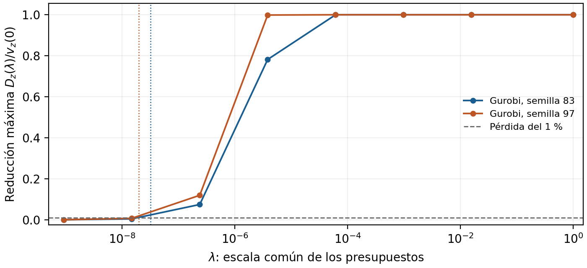

# Presupuestos de residuos, costo y aceptación certificada

**Resultado:** el diagnóstico ajustado identifica el deterioro máximo permitido
por los presupuestos y dos umbrales de factibilidad. La protección al 1 % necesita
una escala muy pequeña, pero basta aplicarla a **40 de 2.836 filas** por patrón,
conservando los presupuestos de todas las cotas continuas. Los diez casos tienen
certificados de protección, específicos del patrón.
Esto es una garantía posterior específica del patrón, no un presupuesto universal
ni evidencia de superioridad computacional. OMS v1.3.5 permanece sin cambios.

## Diseño y alcance

Se parte de las 72 entregas de los 80 tratamientos previos. Se identifican
41 patrones enteros únicos: 12 de nive y 29 de los otros cuatro modelos.
Las semillas, solvers y controles son los ya guardados; no se resuelve otro MILP.
Se usan todos los patrones y se mantienen las ocho ausencias originales.
Los tratamientos L2/Budget de nive repiten patrones para una misma semilla.
El estudio es retrospectivo: los otros modelos ya estaban seleccionados y control
es referencia conocida, no validación poblacional nueva.

Primero se fijaron 178 tareas LP: v(0)/v(1) para los 41 patrones; siete escalas
diádicas intermedias y un umbral de factibilidad para los 12 de nive. Después,
según la regla fijada en PROTOCOL.md, diez LP de umbral de pérdida al 1 % y diez
LP de validación del factor seguro. La variante selectiva se declaró después de
observar esos resultados, antes de sus diez LP adicionales. Total: 208 llamadas,
2 s por LP, watchdog 4 s. No hay sustituciones ni reintentos de casos favorables.

## Qué mide v(lambda)

Se fijan los enteros z y sus cotas exactas. Solo las filas y cotas continuas se
amplían por lambda*delta y lambda*beta. La igualdad tiene ambos lados ampliados.
Los presupuestos iniciales son algebraicos: delta=1e-4 max(1,|RHS|), beta=1e-4.
No representan tolerancias de UTE/ADME u otro operador.

v(lambda) es el menor costo posible en esa región ampliada. Si el patrón es
exactamente factible, D(lambda)=v(0)-v(lambda) mide una vulnerabilidad potencial,
no el error efectivamente observado en cada entrega nativa. La precisión del
cálculo de c^T x sigue siendo correcta. Cada mínimo aquí se comprueba por igualdad
primal/dual exacta; cada inviabilidad, por rayo original verificado.

## Generalización del diagnóstico, sin atribuir fallos a los solvers

| Modelo | Patrones únicos | Inviables exactos | Pérdida potencial v(0)-v(1), % de abs(v(0)) |
|---|---:|---:|---:|
| breastcancer-regularized | 9 | 0 | 0.000038--0.000045 |
| control30-3-2-3 | 11 | 0 | 4.816688--7.648345 |
| neos-1112787 | 8 | 0 | 0.000917--0.000941 |
| neos-3083784-nive | 12 | 2 | 100.000066--100.000142 |
| neos-3661949-lesse | 1 | 0 | 0.000000--0.000000 |

En control hay entre 4,82 % y 7,65 % de deterioro potencial. Clasificación y
neos-1112787 tienen pérdidas menores que 0,001 %; lesse, cero. En nive, los diez
patrones factibles permiten prácticamente borrar su costo. v(1) es aproximadamente -0,0396 allí:
el pequeño valor negativo procede de ampliar también cotas de no negatividad;
no se interpreta como un costo físicamente factible ni como valor nativo reportado.
Los otros dos patrones nive son inviables exactamente y factibles con lambda=1.

## Sensibilidad ajustada de nive



Los puntos son óptimos certificados; las líneas unen muestras y no certifican
la interpolación. Las verticales marcan umbrales exactos para permitir una pérdida
del 1 % (objetivo umbral redondeado hacia arriba a múltiplos de 2^-40).

| Solver | Semilla | v(0) | Umbral lambda | Factor seguro diádico |
|---|---:|---:|---:|---:|
| Gurobi | 83 | 59631 | 3.18712e-08 | 1/33554432 |
| Gurobi | 97 | 37251 | 1.99097e-08 | 1/67108864 |
| HiGHS | 83 | inviable | 0.000253768 | -- |
| HiGHS | 97 | inviable | 0.000248862 | -- |

En Gurobi el umbral es de costo; en HiGHS es de factibilidad, magnitudes distintas.
Los umbrales positivos HiGHS indican la mínima ampliación común que vuelve
factible ese patrón. No son umbrales de un solver ni parámetros operativos.
Los enteros y sus cotas nunca se relajan.

Para los diez patrones factibles, los umbrales al 1 % van de aproximadamente
1,489e-8 a 3,187e-8. La optimización ajustada y la cota dual fija dan el mismo
factor diádico en los diez casos. Por tanto, el gran Delta al presupuesto completo
no implica que sea inútil cerca de cero: protege correctamente la pérdida pequeña.
No se obtiene aquí una mejora de factor seguro por reoptimizar el dual.

## Presupuestos selectivos que protegen el costo

Sea pi un dual de v(0), con todas las cotas continuas escritas como filas.
Se reducen por el factor seguro solo los presupuestos con multiplicador no nulo.
Los demás permanecen iguales. La misma dualidad da costo >= v(0)-factor*Delta,
y factor*Delta<=epsilon. Las igualdades comparten presupuesto para ambos lados.

La primera variante cambia **40/2.836 filas (1,41 %)** y reduce presupuestos de
cota de 396 variables continuas. Los diez LP selectivos tienen primal/dual
exacto y cumplen el límite del 1 %. La comprobación siguiente conserva **todas**
las cotas: su contribución al deterioro es aproximadamente 0,0396, muy inferior al margen
del 1 %. Se asigna el margen restante a las filas activas y se prueba la
protección con el primal y dual existentes, sin otra llamada LP. Basta reducir
40 filas; los otros presupuestos quedan intactos. No hay intervalos de factores
incompatibles con ventana [1e-9,1e9] e hipótesis exportada epsilon=1e-6, tanto
para la variante uniforme como selectiva. Admisibilidad no prueba rendimiento.

En las 12 entregas nativas con patrón factible de nive, esta asignación conserva
8 y rechaza los cuatro ceros Gurobi. Las cuatro salidas HiGHS
inviables necesitan sus certificados de patrón; no están cubiertas por estas
precisiones calculadas para patrones factibles.

La garantía requiere conocer el patrón y su certificado. Cambiar los enteros
exige otro certificado: proteger el costo de patrones factibles no certifica
la factibilidad de los otros dos. Estos presupuestos no se presentan como una
política global de exportación ni como mejora demostrada sobre controles nativos.

## Filtro de aceptación y comparación con reparación

Se acepta un costo nominal C solo si existe un testigo exacto con los mismos
enteros y costo U<=C+epsilon, epsilon=max(1e-6,abs(U)/100). Esto garantiza una
continuación de costo no mayor que C+epsilon. Es protección unilateral; no es
una cota de exceso de costo, un gap ni optimalidad global.

En el replay de los 80 tratamientos, el filtro conserva 64 entregas nominales,
corrige cuatro ceros Gurobi y se abstiene en 12 casos (ocho sin entrega previa
y cuatro salidas con patrón inviable HiGHS). Los dos patrones HiGHS se repiten.
La reparación exacta con la misma cache conserva 28 entradas ya exactas,
corrige 40 y se abstiene en los mismos 12. El filtro conserva 36 entregas
adicionales sin activar corrección; no evita las llamadas para adquirir testigos.
Son acciones del flujo, no recuentos de vectores distintos: convertir un testigo
racional puede devolver las mismas coordenadas binary64 del punto original.

Ambos usan las mismas 33 adquisiciones LP por patrón, con costo observado
agregado 10.355 s. Esa imputación retrospectiva no es un ensayo end-to-end.
La reparación ya proporciona la misma existencia de continuación; no se reclama
una ventaja de trabajo solver o confiabilidad frente a ella. La mejora concreta
es la regla explícita para informar costo respaldado y abstenerse/corregir.

## Verificación, límites y decisión

Se comprobaron 195 certificados óptimos nativos y 12 rayos de infeasibilidad de
los LP ampliados. Un LP de umbral devolvió un error numérico: se guarda intacto.
Su umbral cero se prueba sin resolver de nuevo, usando el primal ya certificado
de v(0) y el dual de lambda>=0. No se oculta como una resolución exitosa.

Una corrección del constructor, detectada por los tests antes de la primera
llamada LP, preservó los coeficientes de las cotas de lambda. Se conservan el
diseño anterior y la corrección pre-solve; no cambian muestras o parámetros.
Los costos totales adicionales fueron 87.927 s, de los cuales 22.885 s fueron
llamadas al ejecutable. Preparación, replay y construcción documental se miden
fuera; no extrapolar el promedio a otros tamaños. La representación es la
canónica binary64; en nive todos los literales originales son exactos en ella.

**Conclusión de investigación:** hay un diagnóstico ajustado y una asignación
selectiva verificable que protege el costo de un patrón ya auditado. Hay señal
fuera de nive en control, con límites explícitos sobre potencial frente a observado.
Todavía no hay una ventaja algorítmica frente a reparación exacta ni protección
preventiva para enteros desconocidos. No se amplía OMS v1.3.5 ni se anuncia otro
paper a partir de esta tanda.

## Reproducción y antecedentes

```bash
python3 exploration/oms-objective-budget-20261014/independent_check.py
python3 -m pytest -q exploration/oms-objective-budget-20261014/test_rational_lp.py exploration/oms-objective-budget-20261014/test_policy.py
python3 exploration/oms-objective-budget-20261014/write_report.py
```

El replay usa Python/NumPy y ninguna llamada solver. La figura requiere Matplotlib.
Los seis tests cubren signos, estacionariedad de variables libres, rayos,
igualdades, dominios enteros, cotas de lambda y reglas de aceptación de costo.
El paquete valida hashes, reconstrucción independiente de cada LP desde el modelo
original, todos los primales/duales y el PDF recompilado desde una extracción limpia.

La sensibilidad y dualidad empleadas son conocidas: véase la sección 5.6 de
[Boyd–Vandenberghe](https://web.stanford.edu/~boyd/cvxbook/bv_cvxbook.pdf).
La aritmética racional sigue las capacidades de
[SoPlex exacto](https://soplex.zib.de/doc/html/EXACT.php).
La reparación y certificación tienen antecedentes como
[Eifler–Gleixner](https://arxiv.org/abs/2101.09141).
El aporte comprobado aquí es la aplicación, medida y trazabilidad del diagnóstico,
no inventar esas herramientas matemáticas.
