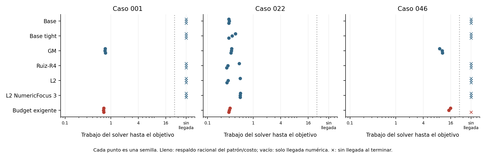

# Frontera precisión–trabajo con calidad común

**Con cada política fija, cambiar solo el presupuesto de aceptación no cambia ninguna primera llegada. La calidad del objetivo determina la entrega. Recalcular factores con otro presupuesto sí puede cambiar la búsqueda. El contrato exigente gana al conjunto de controles en 3/27 comparaciones, concentradas en un modelo, y pierde en otros. No aparece una ventaja general ni un intercambio práctico precisión/trabajo; OMS permanece sin cambios.**

## Diseño ejecutado

Tres modelos SG-Ter-Mer de 360 períodos y enteros originales: 001,022,046,
posiciones 1,3,6 del banco físico limpio anterior. Son modelos conocidos,
seleccionados antes de estas corridas; el ensayo es prospectivo en semillas y
parámetros, no validación de generalización a otros modelos. Se mantienen
Base.lp y su interpretación binary64; no se usa el ejecutable del generador.

90 brazos, **63 MILP reales** después de deduplicar,
semillas 401/409/419. Gurobi 13.0.2, cuatro hilos, presolve y escalado internos
automáticos, IntegralityFocus=1, tolerancia entera común 1e-9, primal 1e-6 salvo
Tight (1e-9), gap .1 %, 15 s / 16 unidades de trabajo. Corridas secuenciales.
Se conservan **1093 eventos de candidatos**, incluidos MIPSOL
que no mejoran el incumbente y puntos finales. Un parámetro nominal no garantiza
el residuo de la fila exportada ni la precisión original observada.

GM, Ruiz y L2 son diádicos y tienen la misma ventana [1e-9,1e9], sin banda
identidad ni escalado de columnas. Budget usa el mismo candidato L2 e impone
epsilon/alpha+E<=delta, reservando E=gamma sum_enteros|aij|. Se comprobaron
exactamente todos los productos coeficiente/RHS; el error de exportación es cero.
El escenario exigente cambia 1440 activaciones por modelo. Referencia y permisivo
coinciden con L2; no se repiten las resoluciones. GCD examina 1080 filas por
modelo, todas ya primitivas y con RHS entero: coincide con Base. Nunca se aplica
piso del RHS en filas con variables continuas.

## Objetivo y precisión común

| Caso | Testigo racional previo U | Umbral común Ccap |
|---|---:|---:|
| instance001 | -989879.473517 | -979980.678782 |
| instance022 | -292995.511676 | -290065.556559 |
| instance046 | -799086.097591 | -791095.236615 |

Se adquirió cada testigo antes de los MILP mediante un LP racional con el patrón
de un testigo GM anterior, verificando todas las filas/cotas del Base original.
U es una referencia factible, no un óptimo. Ccap=U+.01 max(1,|U|) es una aspiración
común con información offline; no es un gap certificado y esos puntos nunca se
utilizan como Start. La adquisición costó
5.323 s en total, fuera
de las fronteras nativas. No se obtiene gratuitamente en un algoritmo general.

Las precisiones autorizadas son (MW,m3): exigente (.01,100), referencia (.1,1000)
y permisiva (1,10000). Se comprueban después de redondear los enteros, sobre
potencia, envolventes, balances y activaciones de volumen, con conversión de
unidades por fila. Son objetivos numéricos del estudio, no estándares del operador.
Otras filas tienen presupuesto auxiliar 1e-8 max(1,|RHS|); cotas, 1e-6 absoluto.
Estos últimos criterios se declaran, no se presentan como validación física.

**Resultado central:** en 90/90
brazos, las primeras llegadas son idénticas para las tres precisiones (o faltan
en las tres), **manteniendo fija la política y sus factores**. La envolvente
del mismo conjunto de políticas coincide sobre esta grilla de aceptación.
La falta de calidad, no una precisión física insuficiente, discrimina las
entregas en esta prueba. No se extrapola a presupuestos no ensayados.

Esto no significa que la política contractual sea insensible al presupuesto.
Al recalcular factores, Budget-Demanding puede llegar donde Budget-Reference y
Budget-Permissive no llegan: las últimas coinciden con L2. En 001 el exigente
llega 3/3 y los otros dos 0/3. La selección contractual cambia la búsqueda aun
cuando los puntos disponibles ya pasan las precisiones físicas. No se afirma
monotonía del rendimiento al variar el presupuesto que diseña el escalamiento.

Primera llegada: candidato que pasa todos esos controles y tiene C<=Ccap.
Todos los residuos y costos se evalúan exactamente. Se emplea una acumulación
entera de los datos diádicos, comprobada por un segundo algoritmo de exponentes
por fila y un parser independiente de Base.lp. Alinear exponentes no se presenta
como novedad matemática. Se detectaron 147 asignaciones brazo/escenario
con precisión alcanzada pero sin calidad común al terminar; son observaciones
correlacionadas por reutilización, no una tasa poblacional de fallos.

## Trabajo hasta obtener precisión y calidad

| Caso | Política | Llegadas exigentes | Respaldadas | Trabajo mediano de las llegadas |
|---|---|---:|---:|---:|
| instance001 | Base | 0/3 | 0/3 | -- |
| instance001 | Base tight | 0/3 | 0/3 | -- |
| instance001 | GM | 3/3 | 3/3 | 0.754 |
| instance001 | Ruiz-R4 | 0/3 | 0/3 | -- |
| instance001 | L2 | 0/3 | 0/3 | -- |
| instance001 | L2 NumericFocus 3 | 0/3 | 0/3 | -- |
| instance001 | Budget exigente | 3/3 | 3/3 | 0.698 |
| instance022 | Base | 3/3 | 3/3 | 0.293 |
| instance022 | Base tight | 3/3 | 3/3 | 0.344 |
| instance022 | GM | 3/3 | 3/3 | 0.333 |
| instance022 | Ruiz-R4 | 3/3 | 3/3 | 0.277 |
| instance022 | L2 | 3/3 | 3/3 | 0.282 |
| instance022 | L2 NumericFocus 3 | 3/3 | 3/3 | 0.517 |
| instance022 | Budget exigente | 3/3 | 3/3 | 0.299 |
| instance046 | Base | 0/3 | 0/3 | -- |
| instance046 | Base tight | 0/3 | 0/3 | -- |
| instance046 | GM | 3/3 | 3/3 | 10.4 |
| instance046 | Ruiz-R4 | 0/3 | 0/3 | -- |
| instance046 | L2 | 0/3 | 0/3 | -- |
| instance046 | L2 NumericFocus 3 | 0/3 | 0/3 | -- |
| instance046 | Budget exigente | 2/3 | 2/3 | 15.2 |

La mediana solo incluye llegadas y debe leerse junto a su denominador. No se
imputa un tiempo corto al fracaso ni se denomina aceleración a una parada temprana
con peor costo. Una cruz en la figura significa sin llegada al terminar; su
posición a la derecha es una categoría, no trabajo realmente consumido.

| Caso | Escenario | Contrato llega | Contrato supera todos los controles | Con respaldo racional |
|---|---|---:|---:|---:|
| instance001 | Demanding | 3/3 | 3/3 | 3/3 |
| instance001 | Reference | 0/3 | 0/3 | 0/3 |
| instance001 | Permissive | 0/3 | 0/3 | 0/3 |
| instance022 | Demanding | 3/3 | 0/3 | 0/3 |
| instance022 | Reference | 3/3 | 0/3 | 0/3 |
| instance022 | Permissive | 3/3 | 0/3 | 0/3 |
| instance046 | Demanding | 2/3 | 0/3 | 0/3 |
| instance046 | Reference | 0/3 | 0/3 | 0/3 |
| instance046 | Permissive | 0/3 | 0/3 | 0/3 |

La política contractual se corresponde con la precisión pedida. Se compara con
el mejor de Base, Tight, GM, Ruiz, L2 y L2-NumericFocus para el mismo modelo,
semilla y objetivo. Ese mejor control es una envolvente retrospectiva, no un
selector gratuito. Ganar esa comparación es evidencia fuerte dentro de esta
muestra; perderla no identifica un control único que gane siempre. Hay 3
llegadas contractuales numéricamente más tempranas y 3 respaldadas.
Referencia/permisivo repiten L2 y no se cuentan como experimentos independientes.
En 001, la razón emparejada mediana Budget/GM es 0.9329, aproximadamente
6.7 % menos trabajo. En 046, GM tiene 3/3 llegadas frente
a 2/3 de Budget, con menor trabajo en las llegadas comparables. Estas diferencias
se conservan aunque no produzcan una ventaja general del contrato.

## Respaldo exacto y costo de la verificación

Se intentó un LP por patrón entero único de las primeras llegadas, sin reemplazar
un patrón que fallara por otro favorable. Son **25 patrones**;
25 llamadas SoPlex y estados {'optimum_certified': 25}.
El costo de construcción, resolución y comprobación fue
43.552 s, fuera del trabajo MILP. Un testigo
del mismo patrón debe tener U<=Ccap y además U<=C+.01 max(1,|U|). Esto respalda
existencia de una continuación y fidelidad unilateral de costo; no certifica
factibilidad exacta del vector flotante original ni óptimo MILP.

Las cotas reportadas se contrastan también con el testigo factible previo:
2 llamadas nativas tienen
una cota que lo excede. La ausencia de contradicción no valida las otras cotas.
No se usa una cota no certificada para declarar calidad común.

La selección se ejecutó y midió de nuevo en cada brazo. Primera llegada se
evalúa retrospectivamente; el callback no detuvo ni modificó el MILP. El costo
de captura (mediana 0.0142 s por llamada) entra en el tiempo
del optimizador. Selección, construcción, persistencia, comprobación y LP exactos
se registran por separado. Un menor trabajo nativo no prueba menor tiempo total
de un controlador online, que no se ha ensayado aquí. No se agregan tiempos de
modelos distintos para proclamar una aceleración.

## Decisión y límites

Con cada política fija, cambiar solo el presupuesto de aceptación no cambia ninguna primera llegada. La calidad del objetivo determina la entrega. Recalcular factores con otro presupuesto sí puede cambiar la búsqueda. El contrato exigente gana al conjunto de controles en 3/27 comparaciones, concentradas en un modelo, y pierde en otros. No aparece una ventaja general ni un intercambio práctico precisión/trabajo; OMS permanece sin cambios.

Son tres modelos de una familia y tres semillas; no un muestreo aleatorio. Las
relaciones no se extrapolan a otro solver. El conjunto ensayado define una
frontera empírica, no el menor trabajo posible entre todos los algoritmos.
Las diferencias de residuos muy inferiores al escenario exigente no representan
por sí solas una utilidad adicional. Este estudio tampoco resuelve LP–DW ni los
límites conjuntos del escalamiento por filas.

Fuentes primarias: [callbacks MIPSOL de Gurobi](https://docs.gurobi.com/projects/optimizer/en/current/reference/numericcodes/callbacks.html),
[parámetros numéricos](https://docs.gurobi.com/projects/optimizer/en/current/concepts/numericguide/numeric_parameters.html)
y [SoPlex exacto](https://soplex.zib.de/doc/html/EXACT.php). El modo de callbacks
puede entregar candidatos que no mejoran el incumbente; por eso se conservan todos.

README.md contiene el replay y las limitaciones. El manifiesto del paquete
incluye entradas, candidatos, secuencias, parámetros, certificados y resultados.
Los ocho paquetes previos y la entrega OMS permanecen protegidos por SHA256.

Nota de importación: el LP usa cotas 1e20 como sentinelas. La API las interpreta
como infinitas, conforme a [Gurobi: atributos de variables](https://docs.gurobi.com/projects/optimizer/en/current/reference/attributes/variable.html).
El parser independiente aplica esa semántica y comprueba además las cotas finitas
literales en todos los candidatos y testigos; no hay que confundir esa normalización
documentada con una modificación contractual. Los modelos canónicos y sus hashes
quedaron fijados antes del primer MILP.
